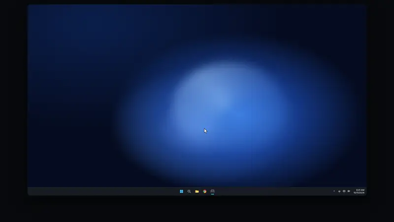
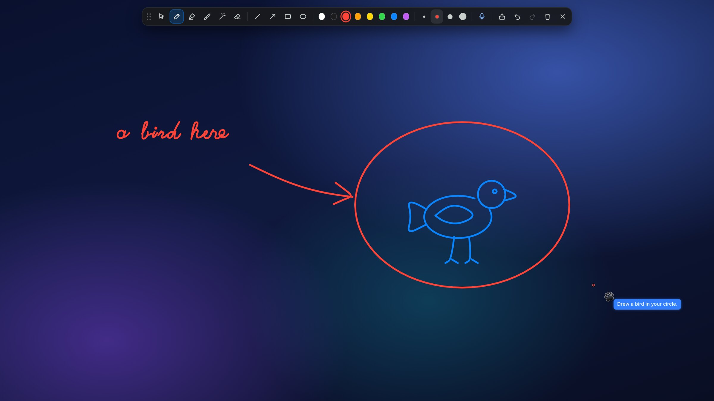
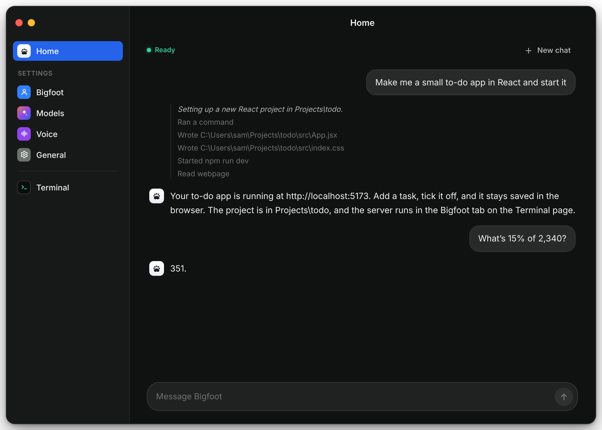
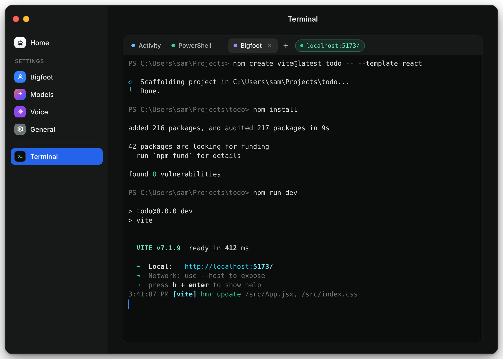
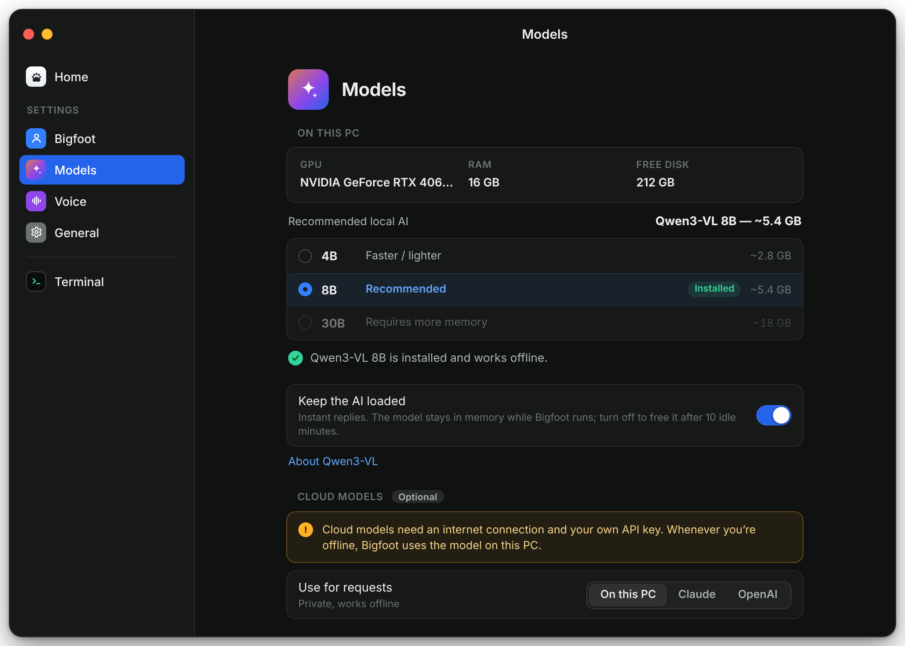
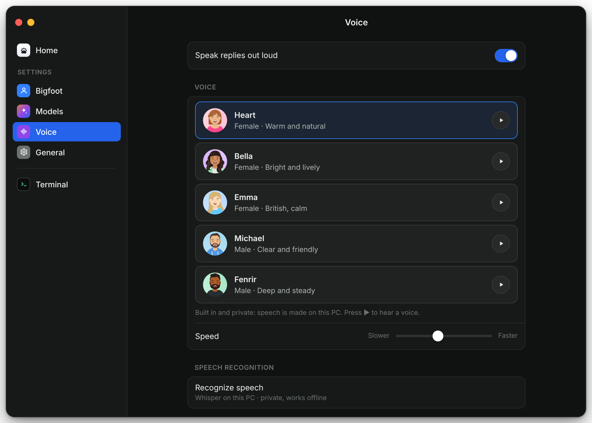
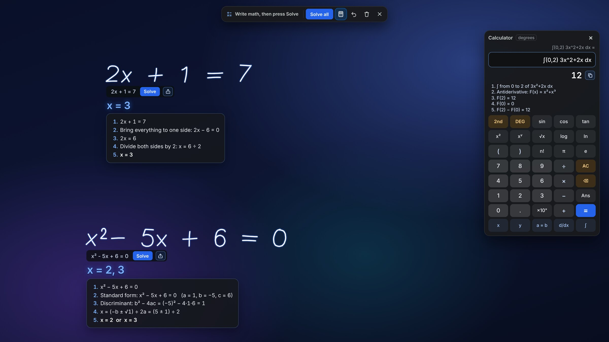
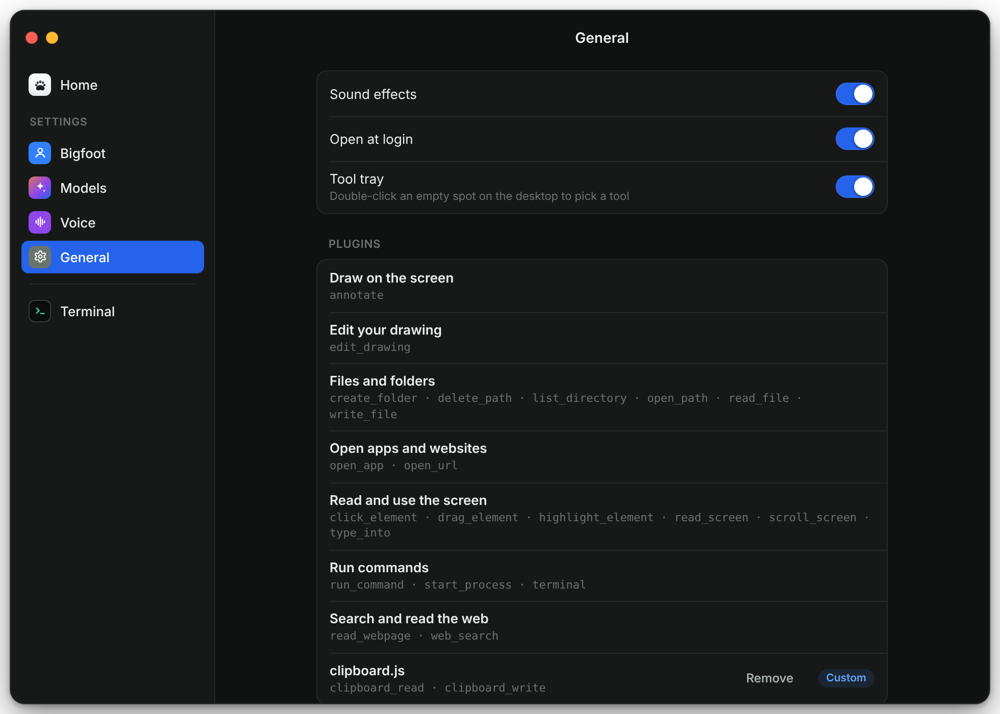

<p align="center">
  
</p>

<h1 align="center">Bigfoot</h1>

<p align="center">
  An assistant that lives next to your cursor on Windows. It sees your screen, talks with you,<br>
  draws on things, solves the math you write, and operates your computer.<br>
  Its AI runs on your PC, so it's private and works offline.
</p>

<p align="center">
  <a href="LICENSE"></a>
  
  
  
</p>

<p align="center">
  <a href=".github/media/bigfoot-launch.mp4"></a>
  <br><sub><a href=".github/media/bigfoot-launch.mp4">Watch with sound (MP4, 0:30)</a></sub>
</p>

<p align="center">
  
</p>

## What it does

- **Talks.** Hold <kbd>Ctrl</kbd>+<kbd>Alt</kbd> to speak, or say "Hey Bigfoot". Speech is recognized by Whisper and answered in one of five built-in voices, all on your PC.
- **Uses your computer.** It opens apps, clicks, types, scrolls, manages files, searches the web and runs commands. It reads the screen the way screen readers do, so it clicks real buttons instead of guessing positions from a picture.
- **Draws.** Annotate anything on screen with a pen, highlighter, shapes and arrows. Ask Bigfoot to neaten, label or add to your drawing, and its edits land in your drawing, where Undo works on them.
- **Solves math.** Write an equation anywhere on the screen and press Solve. Answers come from an exact solver and a symbolic engine with the working shown step by step, never from the AI guessing.
- **Writes code.** Real PowerShell, Command Prompt and Git Bash terminals. Bigfoot writes files, runs builds and tests in its own tab, and starts dev servers you can open with one click.
- **Stays private.** With the local model, screenshots and speech never leave your PC. Cloud models (Claude or OpenAI) are optional and use your own key.

## Screens

| | |
|---|---|
|  |  |
| **Home.** A chat, with every action listed under the request. | **Terminal.** Real shells; Bigfoot works in its own tab. |
|  |  |
| **Models.** Checks your hardware and recommends a model size. | **Voice.** Five built-in voices, made on your PC. |

<p align="center">
  
  <br><b>Math.</b> Handwriting read and solved with the working, plus a scientific calculator that does algebra and calculus.
</p>

## Technical specs

| | |
|---|---|
| Platform | Windows 10 and 11, x64 |
| App | Electron 38, Node.js, plain HTML/CSS/JS renderer with a context-isolated preload bridge |
| Native helper | C# (`InputHelper.cs`), compiled at build time with the compiler that ships with Windows: `SendInput`, UI Automation, wake word, Windows Math Recognizer |
| Local AI | Qwen3-VL 4B, 8B or 30B-A3B (GGUF, Q4_K_M with Q8_0 vision projector), served by llama.cpp b11276 (Vulkan on x64, CPU on ARM64) on 127.0.0.1 with a per-session key |
| Cloud AI (optional) | Anthropic Claude or OpenAI, with your own API key; used only when online |
| Speech to text | whisper.cpp b5130 with the English base model (q8_0), bundled |
| Text to speech | Kokoro 82M v1.0 (ONNX, uint8) on ONNX Runtime 1.21, on a worker thread; five voices |
| Handwritten math | Pix2Text MFR 1.5 (ONNX), with Windows Math Recognizer and the handwriting recognizer as fallbacks |
| Math engines | Exact arithmetic and equation solver (`math.js`), symbolic algebra and calculus with nerdamer |
| Screen reading | Windows UI Automation: the front window's elements, names, states and positions in about 0.3 s |
| Terminals | node-pty (ConPTY) with xterm.js 6 |
| Downloads | Resumable, every file pinned to an exact upstream revision and checked against its SHA-256 |
| Secrets | API keys encrypted with Windows DPAPI (`safeStorage`), never sent to the UI |
| Installer | NSIS via electron-builder, per-user, no admin rights |

### Choosing a model

The last setup step checks your GPU, memory and disk and recommends a size. You can switch at any time without restarting.

| Size | Download | Good for |
|---|---|---|
| 4B | ~2.8 GB | PCs without a graphics card (8 GB RAM or more), and 4–6 GB graphics cards |
| 8B | ~5.4 GB | 8 GB graphics cards, such as an RTX 4060 |
| 30B | ~18 GB | 20 GB graphics cards and up |

The model runs in RAM, not on disk. 4B needs about 3 GB of free memory; on an 8 GB PC with a browser open it loads and answers slowly because Windows starts swapping, so closing heavy apps helps a lot. On PCs with less than 12 GB, Bigfoot uses a compressed working memory and a single copy of the weights to fit.

The first time the model runs it reads Bigfoot's instructions and tool descriptions once (about 3,500 tokens) and saves the result, so every later start is ready in about a second. On an 8 GB laptop without a graphics card (i5-8350U) a chat answer takes about 8 seconds and a question about the screen about 30; with a graphics card each step takes a few seconds.

## Using it

| | |
|---|---|
| Hold <kbd>Ctrl</kbd>+<kbd>Alt</kbd> | Push to talk; let go when you're done |
| Hold <kbd>Ctrl</kbd>+<kbd>Alt</kbd> and drag | Mark an area of the screen to ask about |
| Say "Hey Bigfoot" (or the name you chose) | Start talking hands-free |
| Double-click an empty spot on the desktop | Open the tool tray: Talk, Point, Draw, Math, Type, Clear |
| <kbd>Esc</kbd> | Stop what Bigfoot is doing, then close the open tool |
| Mouse into the top-left corner | Emergency stop while it's controlling the mouse |

**Talk** stays on until you turn it off, so you can say one request after another, and it works alongside the other tools: draw a circle, then say "neaten my circle" and "add an arrow to it".

**Draw** has a pen (pressure-sensitive with a stylus), highlighter, brush, eraser, line, arrow, rectangle and ellipse, eight colors and four sizes. **Tidy** turns rough lines, circles, rectangles and triangles into clean shapes as you finish them. Bigfoot can draw from a built-in library of pictures and more than 5,000 Tabler icons, or write its own SVG for anything else. **Share** copies the screen with your drawing, or saves it as PNG or SVG.

**Math** reads your handwriting as you write and shows the clean reading under it; tap it to fix a misread symbol. Sums are computed exactly, an answer you wrote yourself is checked, and equations (including several unknowns or several lines solved together), derivatives, integrals, limits, sums and vectors are solved with the working shown. The **calculator** on the Math bar is a scientific calculator that also takes x, y, d/dx and ∫.

**Instant commands** such as "open Spotify", "search for …", "play … on YouTube", "click Sign in" or "scroll down" run straight away without waiting for the AI.

## Privacy and safety

- With the local model, screenshots and audio stay on your PC. With a cloud model, screenshots are sent to that provider only while it works on a request.
- Web searches go to DuckDuckGo (or Bing as a fallback). What pages say is treated as information, never as instructions.
- Deleting files always asks and uses the Recycle Bin. Commands ask for approval unless you turn approvals off. System folders can't be written to, and windows that look like password managers or banks need your permission first.
- Bigfoot's own windows are hidden from screen capture.
- Everything it does is listed on the Terminal page and in `%APPDATA%\Bigfoot\logs\activity.log`.

## Building from source

You need Windows 10 or 11 (x64), Node.js 20 or later, Git, and an internet connection for the first build. The native helper is compiled with the C# compiler that comes with Windows, so no Visual Studio is needed.

```bash
git clone https://github.com/jhmeel/bigfoot.git
cd bigfoot
npm install
npm start          # run from source
npm test           # unit, agent-loop, local AI, plugin, speech and terminal tests
npm run dist       # build dist\Bigfoot-Setup-<version>.exe
```

`npm start` and `npm run dist` compile the native helper when it's missing or out of date, and download the bundled speech recognizer, math reader and voice into `vendor/` (about 400 MB, SHA-256 verified, not committed). The installer ends up in `dist`. To rebuild the helper by hand, run `npm run build:native -- --force`.

`node test/live-input.js` opens Notepad, types and closes it as a live check. `BIGFOOT_DEMO=1` plays every overlay effect once, and `BIGFOOT_PROFILE_DIR` runs a copy with a separate profile.

To sign a release, set `CSC_LINK` and `CSC_KEY_PASSWORD` before `npm run dist`. Unsigned builds show Windows SmartScreen's "Windows protected your PC"; choose **More info › Run anyway**.

### Project layout

```
src/main/             Electron main process
  main.js             startup and wiring
  controller.js       voice and Talk mode, tasks, replies, tool tray, Draw and Math
  agent.js            provider-agnostic agent loop, approvals, offline fallback
  llm/                local Qwen3-VL, Claude and OpenAI providers
  local/              model catalog, hardware check, downloads, llama.cpp runtime, Whisper
  math.js cas.js      exact arithmetic, equation solver, symbolic engine
  mathink.js mathread.js  reading handwritten math
  computer.js         mouse and keyboard actions
  capture.js          screenshots and coordinate mapping
  screenread.js       the screen as a list of elements (UI Automation)
  uicommand.js        commands done without the AI ("click …", "scroll down")
  kokoro.js           the built-in voice
  terminals.js        real terminals for the Terminal page and the AI
  plugins/            tool registry, built-in tools, plugin validator
  native/             the C# input helper
src/renderer/         overlay (buddy, Draw, Math), tool tray, main window, onboarding, audio
scripts/              build steps: native helper, icons, bundled models
examples/plugins/     an example plugin
build/                app icon and installer additions
```

### Plugins

A plugin is a `.js` file that gives the AI new tools. **Settings › General › Add Plugin…** opens beside a template you can copy, checks your file in a separate process (syntax, tool definitions, schemas, name clashes), shows what its code can access, and installs it only when you confirm. See [examples/plugins/clipboard.js](examples/plugins/clipboard.js) for a working example. Plugins run with the same access as Bigfoot, so only install ones you wrote or trust.



## Third-party components

| Component | License |
|---|---|
| [Qwen3-VL](https://huggingface.co/Qwen) GGUF models, downloaded on first run | Apache-2.0 |
| [llama.cpp](https://github.com/ggml-org/llama.cpp) b11276, downloaded on first run | MIT |
| [whisper.cpp](https://github.com/ggml-org/whisper.cpp) b5130 and its English base model | MIT |
| [Kokoro 82M v1.0 ONNX](https://huggingface.co/onnx-community/Kokoro-82M-v1.0-ONNX) | Apache-2.0 |
| [phonemizer.js](https://github.com/xenova/phonemizer.js) 1.2.1, including eSpeak NG | Apache-2.0; eSpeak NG is GPL-3.0 |
| [Pix2Text MFR 1.5](https://huggingface.co/breezedeus/pix2text-mfr-1.5) | MIT |
| [ONNX Runtime](https://github.com/microsoft/onnxruntime) | MIT |
| [nerdamer](https://github.com/together-science/nerdamer-prime) | MIT |
| [xterm.js](https://github.com/xtermjs/xterm.js) and [node-pty](https://github.com/microsoft/node-pty) | MIT |
| [Tabler Icons](https://tabler.io/icons) 3.48 | MIT |
| Voice avatars: [DiceBear](https://www.dicebear.com) "Avataaars" by Pablo Stanley | Free for personal and commercial use |

## License

Bigfoot is free software, released under the [GNU General Public License v3.0](LICENSE) or (at your option) any later version. It ships eSpeak NG, which is GPL-3.0, so the app as a whole is distributed under the same terms.
